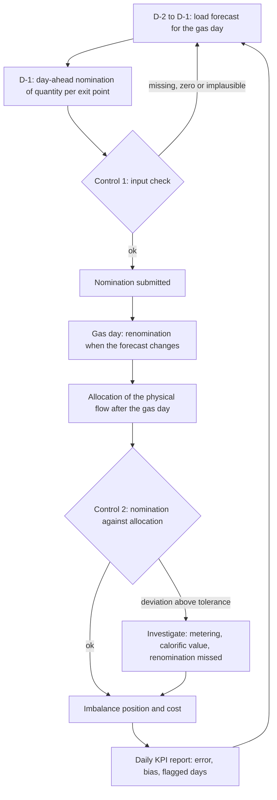

# Nomination process at an exit point: map of the steps and what this repository implements

A generic description of the daily cycle of a shipper that nominates gas to an exit point, drawn to show where forecasts, checks and reports sit. It is **not** the procedure of any network operator or company: the rules of the GB Uniform Network Code and of the GNI Code of Operations were not read, so deadlines, tolerances and charges are not stated here.

| Step | What the repository does | File |
|---|---|---|
| Day-ahead forecast of the nomination | Five forecasts evaluated walk-forward 2024 to 2026 (same weekday last week, two days ago, two ridge models, gradient boosting) | `scripts/run_nominations.py`, `src/nbpie/nominations.py` |
| Control 1: input check | Missing days and values, non-positive values, implied calorific value outside 10 to 12 kWh/m3 | `nominations.controls` |
| Control 2: nomination against flow | Nomination against flow times the rolling median calorific value, tolerance 10% | `nominations.controls` |
| Imbalance position | An assumed charge of 3% of the gas price per MWh of error; the actual charging rules were not used | `nominations.imbalance_cost` |
| Daily KPI report | Mean error, bias, 95th percentile error, flagged days (`results/nominations_summary.json`, `nomination_flagged_days.csv`) | `scripts/run_nominations.py` |
| Not in the repository | Submission to a system, renomination logic, allocation data, EMIR and REMIT submission of the trades | |

Where the process can be improved, measured on the 970 days of 2024 to 2026: the prevailing nomination equals the physical flow within 0.5% on average, so the final nomination is not the difficult step; the day-ahead forecast is. Moving from last week's value to a ridge model with the day-ahead renewable forecast and the gas price cuts the mean absolute error by about half (see the results in the README).
